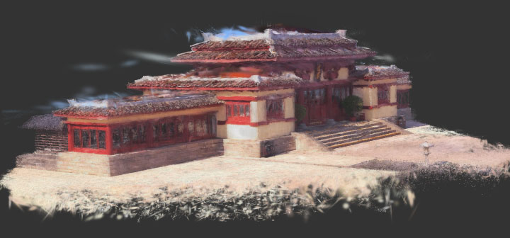
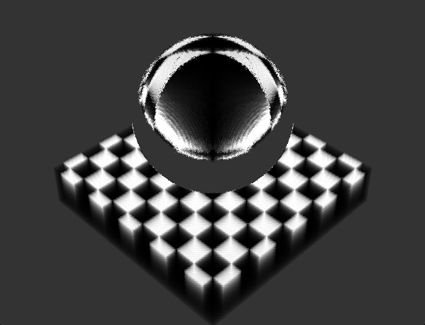

# taichi-volume-renderer
**taichi-volume-renderer** is a python package for real-time **GPU** volume rendering based on [taichi](https://github.com/taichi-dev/taichi).

You don't need to understand Taichi to use this package. For the simplest application — visualizing a 3D scalar NumPy array `a` as volume smoke — you can do it with just one line of code:

```python
import taichi_volume_renderer

taichi_volume_renderer.plot_volume(a)
```

## Installation

```bash
pip install taichi-volume-renderer
```

## Usage

### Dense Scenes

The simplest example would be rendering a static scene, with smoke density, color, and lighting all specified by a few NumPy arrays. See `examples/example.py`.


Volume rendering provides an impressive capability to display faintly visible objects with indistinct boundaries. The following example visualizes a Lorenz attractor. See `examples/strange_attractor.py`.


### Sparse Scenes

The sparse renderer groups 8³ voxel bricks into 128³ sectors and allocates voxel data only for occupied bricks. During ray marching, a missing sector lets the ray skip directly toward that sector's exit. Inside an allocated sector, the ray can skip missing bricks the same way.

A sparse scene can contain multiple entities, each with its own voxel grid, position, and rotation. Ray marching samples each grid in its local coordinates and adds densities where entities overlap. An empty-space jump stops at the earliest next sample across the entities.

We tested the interactive GPU viewer with a scene spanning 4224 × 3840 × 640 voxels. Its bounding box covers over 10 billion voxel positions, with about 726k allocated bricks. Interaction and rendering are real-time (about 40 FPS). Frame rate varies with the hardware, viewport size, and rendering settings.

#### OpenVDB

OpenVDB (`.vdb`) is a familiar interchange format for sparse volumes. The sparse viewer reads active voxels and constant-value tiles into bricks. Install the OpenVDB Python binding (`openvdb` or `pyopenvdb`) and run the viewer from a source checkout.

```bash
python -m examples.sparse_smoke "path/to/cloud.vdb"
```

The importer loads one nonnegative `FloatGrid` with zero background and uniform voxel size as a single entity and preserves its transform. It looks for a grid named `density` first. Use `--grid NAME` to select another grid. The [OpenVDB notebook](examples/openvdb.ipynb) shows how to render a grid after expanding it to a dense array.


#### VXB (recommended)

VDB readers typically rely on the OpenVDB library. A general reader needs to handle several grid types, file versions, and compression options, which makes a standalone decoder more involved. We developed VXB (`.vxb`) so developers can write a decoder for their own language or runtime from a short byte-level specification.

A VXB file stores one Z-up world grid and describes its material fields and brick hierarchy. The decoder reads three kinds of brick records and inflates each top-level payload with standard Deflate. VXB supports uniform bricks and a choice of indexed or direct material values. The reference codec uses only the Python standard library. See the [VXB format overview](docs/vxb.md) and [VXB v1 binary specification](docs/vxb-v1.md).

Open a VXB scene with the sparse viewer.

```bash
python -m examples.sparse_smoke "path/to/world.vxb" --camera saved
```

To save a scene, build a `VxbScene` and pass it to `save_vxb()`. This example writes one uniform 8³ brick at the origin. Material index `0` is reserved for air.

```python
from taichi_volume_renderer.vxb import MaterialField, VxbScene, save_vxb

scene = VxbScene(
    fields=(MaterialField("density", "f32"),),
    materials=((0.0,), (0.5,)),
    brick_sizes=(8,),
    bricks={(0, 0, 0): 1},
)
save_vxb("world.vxb", scene)
```

To simplify hidden material variation before saving, call `merge_hidden_materials(scene, target_materials)` from `taichi_volume_renderer.vxb_optimize`. Pass palette indices or direct material rows. The function estimates transmission from the selected region's boundary using its voxel densities. Below `transmission_threshold=0.01`, it replaces selected voxels with the most common hidden material and merges uniform bricks. Pass `enabled=False` to preserve the original scene.

#### Limestone fountain example

The procedural fountain in `examples/fountain` generates carved limestone, water jets, and foam. The VXB stores a saved camera and 200 clustered pool-surface normals. Caustics are baked when the viewer loads the scene. Pass `--no-merge-hidden-materials` when generating the scene to preserve interior stone colors.

From a source checkout, install the project and Numba, then generate the scene.

```bash
python -m pip install -e . numba
python -m examples.fountain "path/to/fountain.vxb"
```

Open the VXB with the sparse viewer using the reference camera, lighting, and display settings.

```bash
python -m examples.sparse_smoke "path/to/fountain.vxb" --arch cuda --camera saved --resolution 1024 607 --fixed-resolution --vertical-fov 37 --step 0.52 --light-step 1.4 --light-direction -0.71 -0.53 0.45 --light-rgb 14.72 13.28 11.36 --ambient-light 0.60 0.65 0.73 --highlight-shoulder 0.76 --refractive-shadow-passthrough 0.5 --caustic-multiplier 4 --caustic-dispersion 0.05
```

#### CXW

The sparse viewer imports packed-color CXW (`.cxw`) v7/v8 scenes and preserves their separate entities and transforms.

```bash
python -m examples.sparse_smoke "path/to/world.cxw" --camera saved
```

In Python, use `DisplayWindow.from_file()` or `DisplayWindow.from_cxw()`. The CXW reader converts Y-up entity transforms and the saved player pose to Z-up at import. Brick indices stay in entity-local coordinates.

CXW v7/v8 stores 16-bit block codes. Direct float storage is a renderer option. The importer reads packed RGB colors, uses zero density for air, and assigns occupied voxels a default density of 0.22. Use `--density` to change the occupied voxel density. The default `--storage auto` keeps the block codes as indices. In Python, pass `storage=` to either loading method to select another storage mode.

For CXW, either `--refraction-mode interface` or `--refraction-mode gradient` enables refraction with preset indices for air and water (palette ID 3) and a low density for water.

##### Convert CXW to VXB

Convert a packed-color CXW v7/v8 file with one untransformed occupied entity from the repository root.

```bash
python -m scripts.cxw_to_vxb "path/to/world.cxw" "path/to/world.vxb"
```

The converter preserves occupied voxels, original block codes, packed surface emission, and the saved camera pose. It uses the CXW importer's RGB and density defaults for the renderable material values. CXW previews and auxiliary slots are omitted.

#### Renderer Details

Use `--thicken-ground N` or `thicken_ground=N` in `DisplayWindow.from_file()` to extend the lowest non-air voxel of each column downward by `N` voxels. The grid needs an axis parallel to world Z. The default is `0` (disabled). Ground thickening can significantly slow loading for large scenes.

Use `--camera saved` when the file contains a camera pose, or omit it for an overview. Run `python -m examples.sparse_smoke --help` to list all command-line options.

Indexed VXB materials can supply their own `ior`. The indexed Python API also accepts a 65536-element `index_of_refraction=` table for scenes loaded from other sources.

For an indexed VXB interface, a nonzero world-space normal supplied as `normal_x`, `normal_y`, and `normal_z` overrides the estimate. The ray first tries the destination refractive material, then the incident refractive material. Indexed VXB also supports `emission_r`, `emission_g`, and `emission_b` as linear outgoing radiance added after ordinary lighting.

```python
from taichi_volume_renderer import DisplayWindow

window = DisplayWindow.from_file("path/to/world.vxb")
window.show()
```

The VXB renderer follows the brick hierarchy declared in the file. Uniform bricks retain their original size. Mixed bricks cache outgoing radiance per voxel. Uniform bricks share one cached value, with direct lighting sampled at the center and caustic energy averaged over the brick. Straight rays and gradient refraction preserve the sample positions during a jump. Interface refraction resumes sampling just beyond the empty cell boundary on a jump longer than one regular step.

| Sparse storage mode | Behavior |
| --- | --- |
| `auto` (default) | Follows the VXB file's storage mode, uses `indexed` for CXW block codes, and uses `direct` for VDB densities. |
| `indexed` | A 16-bit code into a `(65536, 4)` RGB-density material table. Code zero is air. |
| `direct` | A float32 density with uniform white color, or float32 RGB plus density. |

The renderer reads `r`, `g`, `b`, and `density` from VXB and supports up to 65536 material rows in indexed mode.

Use `--storage direct` to force float storage or `--storage indexed` to force material indices. Indexed storage reserves code 0 for air and fails if there are more than 65535 distinct non-air values. The same options are available as `storage=` in `DisplayWindow.from_file()`.

Other importers can pass float densities shaped `(brick_count, 512)` or float RGB-density values shaped `(brick_count, 512, 4)` as `SparseVolumeData.blocks`.

### Real-Time Visualization

The **taichi-volume-renderer** is built to work flawlessly with Taichi, enabling dynamic scene visualization. The following example solves a partial differential equation (PDE), specifically the Gray-Scott model, while visualizing the system's evolution in real-time. The script also saves an `.gif` animation. See `examples/pde.py`.


I also made a video demonstrating the dazzlingly complex behavior of this system through parameter changes. Check it out at https://www.bilibili.com/video/BV1g7LVzVEQW/

### Canvas

You can use **taichi_volume_renderer.canvas** to draw in 3D space. This module offers rich and user-friendly drawing functionalities.

Note that these drawing methods fundamentally differ from traditional 3D mesh creation in conventional modeling software—here, objects are rendered as bitmaps in a 3D voxel array. This relationship is analogous to how SVG vector graphics differ from BMP raster images in 2D. Such an approach unlocks possibilities for entirely new 3D design workflows.

See `examples/canvas.py`.


### Lighting

The Python API defaults to point lighting. To use a directional light, pass the direction toward the source and its RGB intensity. For example, `directional_light=((0, 0, 1), (8, 8, 8))` gives white light from above. Set `ambient_light=(R, G, B)` to add unshadowed light. Its default is `(0, 0, 0)`.

Lighting is sampled at voxel centers in mixed bricks and at brick centers in uniform bricks. The sparse renderer caches outgoing radiance after applying material color and adding emission. Its cache can use one channel for grayscale materials under white light without emission or caustics. Light rays advance three voxel widths per step by default.

The sparse CLI viewer defaults to an overhead directional light with RGB intensity `(8, 8, 8)`. Use `--light-type point` for point lighting, `--no-lighting` for uniform illumination, or `--ambient-light R G B` to set the ambient light.

#### Environment reflections

The sparse Python API accepts `reflection_environment=(sky_rgb, sun_rgb)` as a render-time option. The default is `None`, which uses the background color for the Fresnel reflection. Setting it requires `lighting=True` and a `directional_light`. Supply finite, nonnegative linear RGB values for `sky_rgb` and `sun_rgb`.

- `sky_rgb` is the added radiance for a reflection pointing straight up (+Z). Reflections pointing toward the horizon or below it receive zero sky contribution.
- `sun_rgb` is the added radiance for a reflection pointing straight toward the directional light. The light's direction is normalized, and the highlight falls off as `max(0, dot(mirror, light_direction))**58`. The exponent is fixed. The directional light's RGB intensity controls direct illumination, and `sun_rgb` controls the reflected highlight independently.

The renderer adds these terms to the background color for the reflected portion of an interface interaction and weights the result by Fresnel reflectance and the ray's remaining transmittance. Rays that escape the scene still see the plain background. The option is supplied at render time for any sparse input format.

#### Bake caustics

Caustics are enabled by default for VXB scenes with directional lighting and a material whose `ior` differs from `1`.

- `--no-caustics` disables caustics.
- `--caustic-photon-density N` sets the number of photons per square voxel of projected area. The default is `6`.
- `--caustic-multiplier N` scales the caustic radiance added to the cache. The default is `1`. Use a finite, nonnegative value.
- `--caustic-dispersion D` sets a spectral sample's index to `n + (n - 1) * D * (3 * h - 1)`, where `h` is its hue. Red, green, and blue use hues `0`, `1/3`, and `2/3`. The default is `0`.
- `--caustic-spectral-samples N` sets the number of ray branches at each photon's first refractive interface when dispersion is enabled. Each branch independently draws a hue from a uniform distribution between infrared at `-1/6` and ultraviolet at `1`. The default is `3`.
- `--refractive-shadow-passthrough auto|N` controls directional shadows when refraction is enabled. At `0`, refractive voxels block direct light. At `1`, they cast ordinary volume shadows. Values between `0` and `1` blend the two shadow results. The default, `auto`, uses `0` when caustics are enabled and `1` otherwise. An explicit number overrides `auto`.

The renderer multiplies deposited light by the receiving material's RGB reflectance and adds it to the outgoing radiance cache.

The Python equivalents are `caustics`, `caustic_photon_density`, `caustic_multiplier`, `caustic_dispersion`, `caustic_spectral_samples`, and `refractive_shadow_passthrough`. Pass them to `DisplayWindow.from_file()` or `SparseSmokeScene.from_file()`.

### Off-Screen Rendering

Off-screen rendering runs directly from Python without opening a viewer window. With a static scene and fixed lighting, load the scene and precompute lighting once, then reuse the same scene and pixel buffer for each frame.

```python
import taichi as ti
from taichi_volume_renderer import DisplayWindow

window = DisplayWindow.from_file("path/to/world.vxb")
scene = window.scene
scene.update_light()
scene.update_caustics()

for frame in range(60):
    scene.render(window.pixels)
    ti.tools.imwrite(window.pixels.to_numpy(), f"frame_{frame:03d}.png")
    scene.move_camera(forward=1, right=0, up=0)
```

### Details

Use WASD to move, Q/E to descend or ascend, Shift to move faster, and R to restore the opening view. In first-person mode, drag with the left mouse button to turn in place. W/S and the mouse wheel in the Windows Tk viewer move forward and backward along the view direction. In the Windows Tk viewer, right-click to copy or paste a camera pose as JSON.

World coordinates are **Z-up**, and uniform scaling preserves the scene's proportions.

The Windows viewer defaults to a resizable 1280×720 viewport with a fixed long-edge field of view. Pass `resize=False` to `DisplayWindow.show()` to keep a fixed resolution, or `resize=True` to use resizable Taichi ndarrays with an image-processing callback. Callbacks receive the original Taichi field by default. To use GGUI from Python, initialize Taichi with `ti.vulkan` and pass `ggui=True` to `DisplayWindow.show()`. GGUI displays frames as GPU textures without CPU readback and supports keyboard navigation, mouse drag, and adaptive resolution.

Set `gamma` when creating a scene or display window in Python, or pass it to `plot_volume()`. Gamma is the exponent applied to each material RGB component. Values below the default of `1.0` brighten midtones, and values above it darken them.

Camera rays advance one voxel width per step by default.

## Gaussian Splatting

**Gaussian splatting** is a technique proposed in 2023 for reconstructing 3D models from photos or videos, delivering unprecedented realism. taichi_volume_renderer provides functionality to parse Gaussian splatting data from PLY files and to render Gaussian ellipsoid clouds into volumes.  We captured an video of a traditional Chinese building with a camera and reconstructed it using [**Jawset Postshot**](https://www.jawset.com/) (an application based on Gaussian splatting), then exported it as a `.ply` file. Subsequently, we parsed and rendered the data using taichi_volume_renderer. See `examples/gaussian_splatting.py`. Gaussian splatting files usually range in the hundreds of megabytes, we are not providing the file here.



Why does the rendered Gaussian splatting scene appear dimmer and less vibrant compared to what is displayed in Jawset Postshot? This is because Gaussian splatting incorporates scene lighting in the following way: Objects are composed of numerous Gaussian ellipsoids, and each ellipsoid can exhibit different colors when viewed from different angles (this anisotropy is generated by higher-order coefficients of spherical harmonics). This allows for rich visual effects, such as reflections that shift with the viewpoint.

Currently, our renderer only supports isotropic volumes, meaning we can only use the base colors of these Gaussian ellipsoids—essentially an average of their colors across all viewing angles. Consider a red object. While it appears red from most angles, it may look bright white under direct reflection or darker in backlit conditions. Averaging these colors results in a desaturated red.

Although fully restoring the scene's original dynamic range and lighting details is impossible, we can compensate for some of this color loss by adjusting the gamma value (as done in our demo).

## Refraction

Supplying an index of refraction (IOR) enables refraction in interface mode by default. Interface mode uses the IOR on each side of a sampled boundary and estimates the normal from nearby voxels. By default, Fresnel reflection samples the scene background. At total internal reflection, the ray continues along the reflected direction. After 19 interface interactions, the ray continues without further interface interactions. Use `refraction_mode="gradient"` for a continuous index field. This mode bends the ray according to the local IOR gradient and ends it at total internal reflection.

For dense `DisplayWindow(...)` and `plot_volume()`, pass an `index_of_refraction` field with the same shape as the density field. Sparse inputs supply IOR through the material data or the indexed Python API described under [Sparse Scenes](#sparse-scenes).

With refraction enabled, camera rays are limited to 10000 steps by default. Straight rays have no default step limit. To set the limit explicitly, use `ray_tracing_max_steps=N` for dense scenes or `max_steps=N` for sparse scenes in Python. The sparse CLI uses `--max-steps N`. The sparse renderer counts steps skipped through empty space toward the limit.

The examples pictured below explicitly use `refraction_mode="gradient"` to reproduce the illustrated continuous-gradient behavior. Run the glass ball with `python -m examples.refraction`, the fluid example with `python -m examples.pbf3d`, or the mirage with `python -m examples.mirage`.



The following example uses the Position Based Fluids (PBF) algorithm (Macklin, M. and Müller, M., 2013) to simulate fluids in real-time and renders them as a transparent material. The code is adapted from Ye Kuang's Taichi demo, [pbf2d.py](https://github.com/taichi-dev/taichi/blob/master/python/taichi/examples/simulation/pbf2d.py). Since no meshing is required, the entire pipeline can be executed on the GPU. See `examples/pbf3d.py`.


Continuous distribution of refractive indices is supported, allowing simulating phenomena such as heat haze or mirages. See `examples/mirage.py`.


## Technical Details and Design Choices

The window backend affects how quickly the app responds to keyboard and mouse input, how smoothly the window moves when dragged, and the frame rate. We compared three backends using the same scene on Windows.

| Window backend | Observed behavior on Windows |
| --- | --- |
| GUI | Input lag, stuttering when dragging the window, and UI freezes. |
| GGUI | Responsive interaction and about three times Tk's frame rate in testing. |
| Tk | Responsive interaction, with additional overhead from copying frames to the CPU. |

The sparse command-line viewer defaults to Vulkan and GGUI. Use `--no-ggui` to select the standard window, which is Tk on Windows. Choosing a non-Vulkan compute backend also selects the standard window. In Python, use the `ggui` argument to `DisplayWindow.show()` to select the window backend.

Set `gamma` in Python or use `--gamma` on the sparse command line to adjust material colors. For half-voxel camera steps, set `ray_tracing_step_size_factor=0.5` for dense scenes or `step_length=0.5` for sparse scenes in Python. The sparse command-line equivalent is `--step 0.5`.

Select a [refraction mode](#refraction) with `refraction_mode="gradient"` or `refraction_mode="interface"` in Python. The sparse command line accepts `--refraction-mode gradient` or `--refraction-mode interface`. See [Lighting](#lighting) for light controls.

## TODOs

- Evaluate 3D DCT and quantization for compressing direct-value bricks, measuring file size, decode time, and rendering artifacts
- Default lights
- Background images
- Ray intersection with the scene
- More features of canvas
- Reflection
- Anisotropic volume based on spherical harmonics
- Secondary scattering
