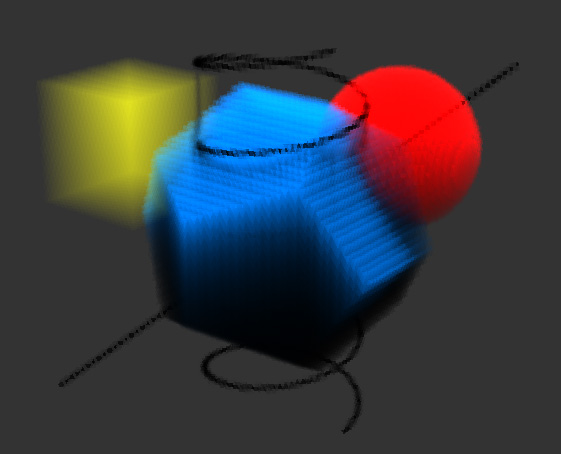
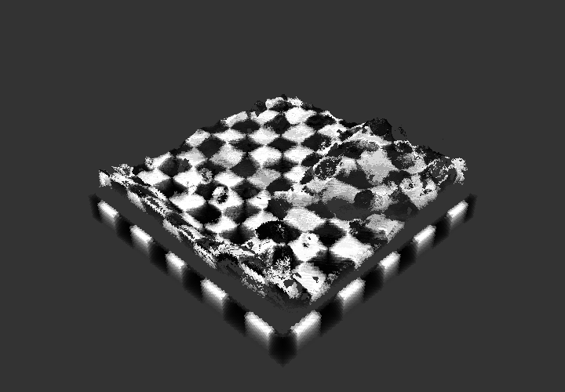
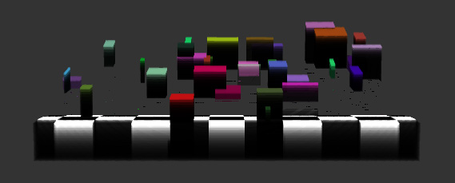

# taichi-volume-renderer
**taichi-volume-renderer** is a python package for real-time **GPU** volume rendering based on [taichi](https://github.com/taichi-dev/taichi).

You don't need to understand Taichi to use this package. For the simplest application — visualizing a 3D scalar NumPy array `a` as volume smoke — you can do it with just one line of code:

```python
import taichi_volume_renderer

taichi_volume_renderer.plot_volume(a)
```

## Installation

```bash
pip install taichi-volume-renderer
```

## Usage

Use WASD to move, Q/E to descend or ascend, Shift to move faster, and R to restore the opening view. In the dense viewer, Tab switches between orbit and first-person controls. In the Windows Tk viewer, right-click to copy or paste a camera pose as JSON.

Both renderers use Z-up world coordinates. The CXW reader converts Y-up entity transforms and the saved player pose at import. Brick indices stay in entity-local coordinates. Clipboard pose JSON keeps its existing Y-up convention in both viewers.

The Windows viewer defaults to a resizable 1280×720 viewport with a fixed long-edge field of view. Pass `resize=False` to `DisplayWindow.show()` to keep a fixed resolution, or `resize=True` to use resizable Taichi ndarrays with an image-processing callback. Callbacks receive the original Taichi field by default.

Dense volumes use one scale for all three axes, so their displayed proportions follow the array dimensions. Dense `Scene`, `DisplayWindow`, and `plot_volume` accept `gamma`, `ambient_light`, and `directional_light`. For example, use `directional_light=((0, 0, 1), (8, 8, 8))` for overhead white light in the dense renderer's Z-up coordinates. White directional and ambient lights share a single-channel cache. The dense renderer keeps all three cache channels for mutable point lights so their color can change between updates.

### Interactive Static Scenes

The simplest example would be rendering a static scene, with smoke density, color, and lighting all specified by a few NumPy arrays. See `examples/example.py`.


Volume rendering provides an impressive capability to display faintly visible objects with indistinct boundaries. The following example visualizes a Lorenz attractor. See `examples/strange_attractor.py`.


### Sparse Smoke Rendering

Open a packed-color CXW v7 or v8 world from a source checkout:

```bash
python -m examples.sparse_smoke "path/to/world.cxw" --camera saved
```

Omit `--camera saved` for an overview. The sparse viewer uses first-person controls. Drag with the left mouse button to turn in place. Use W/S or, in the standard window, the mouse wheel to move forward and backward along the view direction.

Run `python -m examples.sparse_smoke --help` to list all command-line options.

The sparse command-line viewer defaults to Vulkan and GGUI, displaying frames as GPU textures without CPU readback. Use `--no-ggui` to select the standard window, which is Tk on Windows. Choosing a non-Vulkan compute backend also selects the standard window unless GGUI is explicitly requested. In Python, initialize Taichi with `ti.vulkan` and pass `ggui=True` to `DisplayWindow.show()`. GGUI supports keyboard navigation, mouse drag, and adaptive resolution. The Tk viewer provides the wheel and camera clipboard menu.

The dense and sparse smoke renderers use the same compositing and ray step factors. The sparse renderer uses a single scale for all axes to preserve the world's aspect ratio. It precomputes lighting at occupied voxel centers and reads the result from the brick pool during rendering.

The CLI viewer defaults to an overhead directional light with RGB intensity `(8, 8, 8)`. Use `--light-type point` for point lighting or `--no-lighting` for uniform illumination. The Python API defaults to point lighting and accepts `directional_light=((0, 0, 1), (8, 8, 8))` to switch. The direction points towards the source in Z-up world coordinates.

With lighting enabled, `--ambient-light R G B` or `ambient_light=(R, G, B)` adds unshadowed light to every occupied voxel during light precomputation. The default is `(0, 0, 0)`.

For CXW imports, air has zero density and each occupied voxel uses its packed RGB color at a default density of 0.22. Use `--density` to set the occupied voxel density. The default camera and light steps are one and three voxel widths, respectively. Use `--step 0.5` for half-voxel camera steps.

Use `--gamma` on the command line or `gamma=` in `DisplayWindow.from_cxw()` to raise each loaded RGB component to that power. The default is `1.0`. Values below 1 brighten midtone reflectance and values above 1 darken it.

The sparse viewer accepts `--refraction-mode gradient` for a continuous index field or `--refraction-mode interface` for distinct media. The CLI option supplies air and water (packed CXW palette ID 3) indices and uses a low density for water in both modes. The indexed Python API accepts a 65,536-element `index_of_refraction=` table and a `refraction_mode=` value. The default mode for a supplied table is `interface`; without a table, the renderer traces straight rays.

The gradient mode reuses the dense renderer's Snell step and ends the ray at total internal reflection. The interface mode uses the IOR on both sides of a sampled boundary and estimates the normal from nearby voxels. Fresnel reflection samples the scene background; total internal reflection continues inside the scene.

Use `--max-steps N` on the command line or `max_steps=N` in Python to set a sparse camera ray step limit. Both refraction modes default to 10,000 steps. Straight rays have no default step limit. Steps skipped through empty space count toward the limit.

```python
from taichi_volume_renderer import DisplayWindow

window = DisplayWindow.from_cxw("path/to/world.cxw", density=0.22)
window.show()
```

The loader returns `SparseVolumeData`, an in-memory sector index and pool of occupied 8³ bricks. In either storage mode, the renderer jumps over missing sectors and bricks while preserving the ray sample spacing.

| Sparse storage mode | Values stored per voxel slot |
| --- | --- |
| Indexed | A 16-bit code into a `(65536, 4)` RGB-density material table. Code zero is air. |
| Direct | A float32 density with uniform white color, or float32 RGB plus density. |

The default `--storage auto` uses indexed storage for CXW block codes and direct storage for VDB density values. CXW v7/v8 stores a 16-bit block code with no per-file flag for a direct float format. This importer reads packed-color codes.

Use `--storage direct` to force float storage or `--storage indexed` to force material indices. Indexed storage reserves code 0 for air and fails if there are more than 65,535 distinct non-air values. The same options are available as `storage=` in `DisplayWindow.from_file()` and `DisplayWindow.from_cxw()`.

Other importers can pass float densities shaped `(brick_count, 512)` or float RGB-density values shaped `(brick_count, 512, 4)` as `SparseVolumeData.blocks`.

### High-Performance Real-Time Visualization

The **taichi-volume-renderer** is built to work flawlessly with Taichi, enabling dynamic scene visualization. The following example solves a partial differential equation (PDE), specifically the Gray-Scott model, while visualizing the system's evolution in real-time. The script also saves an `.gif` animation. See `examples/pde.py`.


I also made a video demonstrating the dazzlingly complex behavior of this system through parameter changes. Check it out at https://www.bilibili.com/video/BV1g7LVzVEQW/

### Canvas

You can use **taichi_volume_renderer.canvas** to draw in 3D space. This module offers rich and user-friendly drawing functionalities.

Note that these drawing methods fundamentally differ from traditional 3D mesh creation in conventional modeling software—here, objects are rendered as bitmaps in a 3D voxel array. This relationship is analogous to how SVG vector graphics differ from BMP raster images in 2D. Such an approach unlocks possibilities for entirely new 3D design workflows.

See `examples/canvas.py`.



## Gaussian Splatting

**Gaussian splatting** is a technique proposed in 2023 for reconstructing 3D models from photos or videos, delivering unprecedented realism. taichi_volume_renderer provides functionality to parse Gaussian splatting data from PLY files and to render Gaussian ellipsoid clouds into volumes.  We captured an video of a traditional Chinese building with a camera and reconstructed it using [**Jawset Postshot**](https://www.jawset.com/) (an application based on Gaussian splatting), then exported it as a `.ply` file. Subsequently, we parsed and rendered the data using taichi_volume_renderer. See `examples/gaussian_splatting.py`. Gaussian splatting files usually range in the hundreds of megabytes, we are not providing the file here.


Why does the rendered Gaussian splatting scene appear dimmer and less vibrant compared to what is displayed in Jawset Postshot? This is because Gaussian splatting incorporates scene lighting in the following way: Objects are composed of numerous Gaussian ellipsoids, and each ellipsoid can exhibit different colors when viewed from different angles (this anisotropy is generated by higher-order coefficients of spherical harmonics). This allows for rich visual effects, such as reflections that shift with the viewpoint.

Currently, our renderer only supports isotropic volumes, meaning we can only use the base colors of these Gaussian ellipsoids—essentially an average of their colors across all viewing angles. Consider a red object. While it appears red from most angles, it may look bright white under direct reflection or darker in backlit conditions. Averaging these colors results in a desaturated red.

Although fully restoring the scene's original dynamic range and lighting details is impossible, we can compensate for some of this color loss by adjusting the gamma value (as done in our demo).

### VDB

The sparse viewer reads active voxels and constant-value tiles directly into bricks. Install the OpenVDB Python binding (`openvdb` or `pyopenvdb`) and run:

```bash
python -m examples.sparse_smoke "path/to/cloud.vdb"
```

The importer accepts nonnegative `FloatGrid` densities with zero background and uniform voxel size. It prefers a grid named `density`; pass `--grid NAME` to choose another grid. The [OpenVDB notebook](examples/openvdb.ipynb) shows how to render a grid after expanding it to a dense array.


### Refraction

Dense and sparse rendering default to `refraction_mode="interface"` when an index of refraction is supplied. Both use the same normal estimate, refraction and total internal reflection rules. After 19 interface interactions, the ray continues in its current direction. Use `refraction_mode="gradient"` for a continuous index field. For dense `DisplayWindow` and `plot_volume`, pass an `index_of_refraction` field with the same shape as the density field. Both refraction modes default to 10,000 ray steps. Straight rays have no default step limit. Use `ray_tracing_max_steps=N` to set the dense step limit explicitly.

The examples pictured below explicitly use `refraction_mode="gradient"` to reproduce the illustrated continuous-gradient behavior. Run the glass ball with `python -m examples.refraction`, the fluid example with `python -m examples.pbf3d`, or the mirage with `python -m examples.mirage`.


The following example uses the Position Based Fluids (PBF) algorithm (Macklin, M. and Müller, M., 2013) to simulate fluids in real-time and renders them as a transparent material. The code is adapted from Ye Kuang's Taichi demo, [pbf2d.py](https://github.com/taichi-dev/taichi/blob/master/python/taichi/examples/simulation/pbf2d.py). Since no meshing is required, the entire pipeline can be executed on the GPU. See `examples/pbf3d.py`.



Continuous distribution of refractive indices is supported, allowing simulating phenomena such as heat haze or mirages. See `examples/mirage.py`.



## Technical Details and Design Choices

The window backend affects how quickly the app responds to keyboard and mouse input, how smoothly the window moves when dragged, and the frame rate. We compared three backends using the same scene on Windows.

| Window backend | Observed behavior on Windows |
| --- | --- |
| GUI | Input lag, stuttering when dragging the window, and UI freezes. |
| GGUI | Responsive interaction and about three times Tk's frame rate in testing. |
| Tk | Responsive interaction, with additional overhead from copying frames to the CPU. |

## TODOs

- Add a direct-value mode to the on-disk sparse volume format for floating-point density and optional RGB.
- Evaluate 3D DCT and quantization for compressing direct-value bricks, measuring file size, decode time, and rendering artifacts.
- Default lights
- Background images
- Ray intersection with the scene
- More features of canvas
- Reflection
- Anisotropic volume based on spherical harmonics
- Secondary scattering
