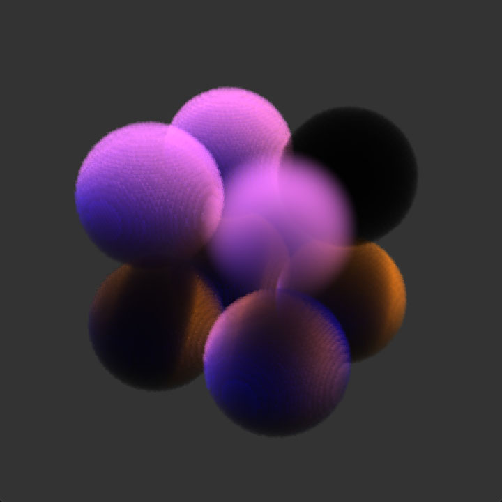

# taichi-volume-renderer
**taichi-volume-renderer** is a python package for real-time **GPU** volume rendering based on [taichi](https://github.com/taichi-dev/taichi).

You don't need to understand Taichi to use this package. For the simplest application — visualizing a 3D scalar NumPy array `a` as volume smoke — you can do it with just one line of code:

```python
import taichi_volume_renderer

taichi_volume_renderer.plot_volume(a)
```

## Installation

```bash
pip install taichi-volume-renderer
```

## Usage

### Dense Scenes

The simplest example would be rendering a static scene, with smoke density, color, and lighting all specified by a few NumPy arrays. See `examples/example.py`.



Volume rendering provides an impressive capability to display faintly visible objects with indistinct boundaries. The following example visualizes a Lorenz attractor. See `examples/strange_attractor.py`.


### Sparse Scenes

The sparse renderer groups 8³ voxel bricks into 128³ sectors and allocates voxel data only for occupied bricks. During ray marching, a missing sector lets the ray skip directly toward that sector's exit. Inside an allocated sector, the ray can skip missing bricks the same way.

The interactive GPU viewer has rendered a scene spanning **4,224 × 3,840 × 640 voxels**. Its bounding box covers over 10 billion voxel positions, with about 726,000 allocated bricks. Frame rate varies with the hardware, viewport size, and rendering settings.

#### OpenVDB

OpenVDB (`.vdb`) is a familiar interchange format for sparse volumes. The sparse viewer reads active voxels and constant-value tiles into bricks. Install the OpenVDB Python binding (`openvdb` or `pyopenvdb`) and run the viewer from a source checkout.

```bash
python -m examples.sparse_smoke "path/to/cloud.vdb"
```

The importer accepts nonnegative `FloatGrid` densities with zero background and uniform voxel size. It looks for a grid named `density` first. Use `--grid NAME` to select another grid. The [OpenVDB notebook](examples/openvdb.ipynb) shows how to render a grid after expanding it to a dense array.


#### VXB

VDB readers typically rely on the OpenVDB library. A general reader needs to handle several grid types, file versions, and compression options, which makes a standalone decoder more involved. We developed VXB (`.vxb`) so developers can write a decoder for their own language or runtime from a short byte-level specification.

A VXB file describes its material fields and brick hierarchy. The decoder reads three kinds of brick records and inflates each top-level payload with standard Deflate. VXB supports uniform bricks and a choice of indexed or direct material values. The reference codec uses only the Python standard library. See the [VXB format overview](docs/vxb.md) and [VXB v1 binary specification](docs/vxb-v1.md).

Open a VXB scene with the sparse viewer.

```bash
python -m examples.sparse_smoke "path/to/world.vxb" --camera saved
```

#### CXW

The sparse viewer imports packed-color CXW (`.cxw`) v7/v8 scenes.

```bash
python -m examples.sparse_smoke "path/to/world.cxw" --camera saved
```

In Python, use `DisplayWindow.from_file()` or `DisplayWindow.from_cxw()`. The CXW reader converts Y-up entity transforms and the saved player pose to Z-up at import. Brick indices stay in entity-local coordinates.

CXW v7/v8 stores 16-bit block codes. Direct float storage is a renderer option. The importer reads packed RGB colors, uses zero density for air, and assigns occupied voxels a default density of 0.22. Use `--density` to change the occupied voxel density. The default `--storage auto` keeps the block codes as indices. In Python, pass `storage=` to either loading method to select another storage mode.

For CXW, either `--refraction-mode interface` or `--refraction-mode gradient` enables refraction with preset indices for air and water (palette ID 3) and a low density for water.

##### Convert CXW to VXB

Convert a packed-color CXW v7/v8 file with one untransformed occupied entity from the repository root.

```bash
python -m scripts.cxw_to_vxb "path/to/world.cxw" "path/to/world.vxb"
```

The converter preserves occupied voxels, original block codes, packed surface emission, and the saved camera pose. It uses the CXW importer's RGB and density defaults for the renderable material values. CXW previews and auxiliary slots are omitted.

#### Sparse viewer options

Use `--camera saved` when the file contains a camera pose, or omit it for an overview. Run `python -m examples.sparse_smoke --help` to list all command-line options. Use `--gamma` to adjust material colors and `--step 0.5` for half-voxel camera steps. See [Lighting](#lighting) for the lighting options.

The sparse command-line viewer defaults to Vulkan and GGUI. Use `--no-ggui` to select the standard window, which is Tk on Windows. Choosing a non-Vulkan compute backend also selects the standard window.

The sparse CLI selects a [refraction mode](#refraction) with `--refraction-mode gradient` or `--refraction-mode interface`. Indexed VXB materials can supply their own `ior`. The indexed Python API also accepts a 65,536-element `index_of_refraction=` table for scenes loaded from other sources.

For an indexed VXB interface, a nonzero world-space normal supplied as `normal_x`, `normal_y`, and `normal_z` overrides the estimate. The ray first tries the destination refractive material, then the incident refractive material. Indexed VXB also supports `emission_r`, `emission_g`, and `emission_b` as linear outgoing radiance added after ordinary lighting.

```python
from taichi_volume_renderer import DisplayWindow

window = DisplayWindow.from_file("path/to/world.vxb")
window.show()
```

The VXB importer adapts the file's hierarchy to the renderer's sector and brick layout, expanding uniform bricks in memory. Straight rays and gradient refraction preserve the sample positions during a jump. Interface refraction resumes sampling just beyond the empty cell boundary on a jump longer than one regular step.

| Sparse storage mode | Values stored per voxel slot |
| --- | --- |
| Indexed | A 16-bit code into a `(65536, 4)` RGB-density material table. Code zero is air. |
| Direct | A float32 density with uniform white color, or float32 RGB plus density. |

The default `--storage auto` uses direct storage for VDB density values. For VXB it follows the file's indexed or direct mode. The renderer reads `r`, `g`, `b`, and `density` from VXB and supports up to 65,536 material rows in indexed mode.

Use `--storage direct` to force float storage or `--storage indexed` to force material indices. Indexed storage reserves code 0 for air and fails if there are more than 65,535 distinct non-air values. The same options are available as `storage=` in `DisplayWindow.from_file()`.

Other importers can pass float densities shaped `(brick_count, 512)` or float RGB-density values shaped `(brick_count, 512, 4)` as `SparseVolumeData.blocks`.

### Real-Time Visualization

The **taichi-volume-renderer** is built to work flawlessly with Taichi, enabling dynamic scene visualization. The following example solves a partial differential equation (PDE), specifically the Gray-Scott model, while visualizing the system's evolution in real-time. The script also saves an `.gif` animation. See `examples/pde.py`.


I also made a video demonstrating the dazzlingly complex behavior of this system through parameter changes. Check it out at https://www.bilibili.com/video/BV1g7LVzVEQW/

### Canvas

You can use **taichi_volume_renderer.canvas** to draw in 3D space. This module offers rich and user-friendly drawing functionalities.

Note that these drawing methods fundamentally differ from traditional 3D mesh creation in conventional modeling software—here, objects are rendered as bitmaps in a 3D voxel array. This relationship is analogous to how SVG vector graphics differ from BMP raster images in 2D. Such an approach unlocks possibilities for entirely new 3D design workflows.

See `examples/canvas.py`.


### Lighting

The Python API defaults to point lighting. To use a directional light, pass the direction toward the source and its RGB intensity. For example, `directional_light=((0, 0, 1), (8, 8, 8))` gives white light from above. Set `ambient_light=(R, G, B)` to add unshadowed light. Its default is `(0, 0, 0)`.

Lighting is cached at voxel centers. When the directional and ambient lights each have equal RGB components, the cache uses one channel. Sparse scenes store the cache in the brick pool. Light rays advance three voxel widths per step by default.

The sparse CLI viewer defaults to an overhead directional light with RGB intensity `(8, 8, 8)`. Use `--light-type point` for point lighting, `--no-lighting` for uniform illumination, or `--ambient-light R G B` to set the ambient light.

#### Environment reflections

The sparse Python API accepts `reflection_environment=(sky_rgb, sun_rgb)` as a render-time option. The default is `None`, which uses the background color for the Fresnel reflection. Setting it requires `lighting=True` and a `directional_light`. Supply finite, nonnegative linear RGB values for `sky_rgb` and `sun_rgb`.

- `sky_rgb` is the added radiance for a reflection pointing straight up (+Z). Reflections pointing toward the horizon or below it receive zero sky contribution.
- `sun_rgb` is the added radiance for a reflection pointing straight toward the directional light. The light's direction is normalized, and the highlight falls off as `max(0, dot(mirror, light_direction))**58`. The exponent is fixed. The directional light's RGB intensity controls direct illumination, and `sun_rgb` controls the reflected highlight independently.

The renderer adds these terms to the background color for the reflected portion of an interface interaction and weights the result by Fresnel reflectance and the ray's remaining transmittance. Rays that escape the scene still see the plain background. The option is supplied at render time for any sparse input format.

### Off-Screen Rendering

For off-screen rendering, create a `DisplayWindow`. Set the camera with methods such as `window.scene.set_camera_phi(30)`, call `window.scene.update_light()`, then render with `window.scene.render(window.pixels)` and retrieve the RGB array with `window.pixels.to_numpy()`. The viewer window opens only when you call `show()`. You can reuse the lighting for multiple views of a static scene.

### Details

Use WASD to move, Q/E to descend or ascend, Shift to move faster, and R to restore the opening view. In first-person mode, drag with the left mouse button to turn in place. W/S and the mouse wheel in the Windows Tk viewer move forward and backward along the view direction. In the Windows Tk viewer, right-click to copy or paste a camera pose as JSON.

World coordinates are **Z-up**, and uniform scaling preserves the scene's proportions.

The Windows viewer defaults to a resizable 1280×720 viewport with a fixed long-edge field of view. Pass `resize=False` to `DisplayWindow.show()` to keep a fixed resolution, or `resize=True` to use resizable Taichi ndarrays with an image-processing callback. Callbacks receive the original Taichi field by default. To use GGUI from Python, initialize Taichi with `ti.vulkan` and pass `ggui=True` to `DisplayWindow.show()`. GGUI displays frames as GPU textures without CPU readback and supports keyboard navigation, mouse drag, and adaptive resolution.

Set `gamma` when creating a scene or display window in Python, or pass it to `plot_volume()`. Gamma is the exponent applied to each material RGB component. Values below the default of `1.0` brighten midtones, and values above it darken them.

Camera rays advance one voxel width per step by default.

## Gaussian Splatting

**Gaussian splatting** is a technique proposed in 2023 for reconstructing 3D models from photos or videos, delivering unprecedented realism. taichi_volume_renderer provides functionality to parse Gaussian splatting data from PLY files and to render Gaussian ellipsoid clouds into volumes.  We captured an video of a traditional Chinese building with a camera and reconstructed it using [**Jawset Postshot**](https://www.jawset.com/) (an application based on Gaussian splatting), then exported it as a `.ply` file. Subsequently, we parsed and rendered the data using taichi_volume_renderer. See `examples/gaussian_splatting.py`. Gaussian splatting files usually range in the hundreds of megabytes, we are not providing the file here.


Why does the rendered Gaussian splatting scene appear dimmer and less vibrant compared to what is displayed in Jawset Postshot? This is because Gaussian splatting incorporates scene lighting in the following way: Objects are composed of numerous Gaussian ellipsoids, and each ellipsoid can exhibit different colors when viewed from different angles (this anisotropy is generated by higher-order coefficients of spherical harmonics). This allows for rich visual effects, such as reflections that shift with the viewpoint.

Currently, our renderer only supports isotropic volumes, meaning we can only use the base colors of these Gaussian ellipsoids—essentially an average of their colors across all viewing angles. Consider a red object. While it appears red from most angles, it may look bright white under direct reflection or darker in backlit conditions. Averaging these colors results in a desaturated red.

Although fully restoring the scene's original dynamic range and lighting details is impossible, we can compensate for some of this color loss by adjusting the gamma value (as done in our demo).

## Refraction

Supplying an index of refraction (IOR) enables refraction in interface mode by default. Interface mode uses the IOR on each side of a sampled boundary and estimates the normal from nearby voxels. By default, Fresnel reflection samples the scene background. At total internal reflection, the ray continues along the reflected direction. After 19 interface interactions, the ray continues without further interface interactions. Use `refraction_mode="gradient"` for a continuous index field. This mode bends the ray according to the local IOR gradient and ends it at total internal reflection.

For dense `DisplayWindow(...)` and `plot_volume()`, pass an `index_of_refraction` field with the same shape as the density field. Sparse inputs supply IOR through the material data or the indexed Python API described under [Sparse Scenes](#sparse-scenes).

With refraction enabled, camera rays are limited to 10,000 steps by default. Straight rays have no default step limit. To set the limit explicitly, use `ray_tracing_max_steps=N` for dense scenes or `max_steps=N` for sparse scenes in Python. The sparse CLI uses `--max-steps N`. The sparse renderer counts steps skipped through empty space toward the limit.

The examples pictured below explicitly use `refraction_mode="gradient"` to reproduce the illustrated continuous-gradient behavior. Run the glass ball with `python -m examples.refraction`, the fluid example with `python -m examples.pbf3d`, or the mirage with `python -m examples.mirage`.


The following example uses the Position Based Fluids (PBF) algorithm (Macklin, M. and Müller, M., 2013) to simulate fluids in real-time and renders them as a transparent material. The code is adapted from Ye Kuang's Taichi demo, [pbf2d.py](https://github.com/taichi-dev/taichi/blob/master/python/taichi/examples/simulation/pbf2d.py). Since no meshing is required, the entire pipeline can be executed on the GPU. See `examples/pbf3d.py`.


Continuous distribution of refractive indices is supported, allowing simulating phenomena such as heat haze or mirages. See `examples/mirage.py`.


## Technical Details and Design Choices

The window backend affects how quickly the app responds to keyboard and mouse input, how smoothly the window moves when dragged, and the frame rate. We compared three backends using the same scene on Windows.

| Window backend | Observed behavior on Windows |
| --- | --- |
| GUI | Input lag, stuttering when dragging the window, and UI freezes. |
| GGUI | Responsive interaction and about three times Tk's frame rate in testing. |
| Tk | Responsive interaction, with additional overhead from copying frames to the CPU. |

## TODOs

- Add a direct-value mode to the on-disk sparse volume format for floating-point density and optional RGB.
- Evaluate 3D DCT and quantization for compressing direct-value bricks, measuring file size, decode time, and rendering artifacts.
- Default lights
- Background images
- Ray intersection with the scene
- More features of canvas
- Reflection
- Anisotropic volume based on spherical harmonics
- Secondary scattering
