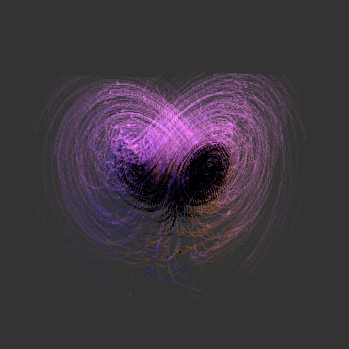
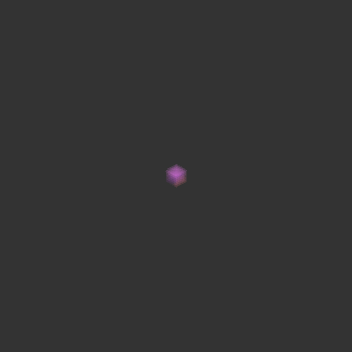
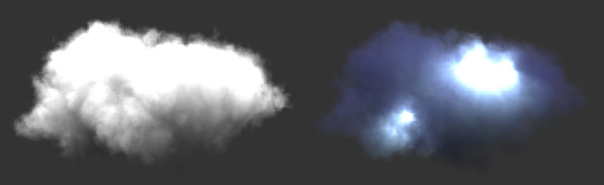

# taichi-volume-renderer
**taichi-volume-renderer** is a python package for real-time **GPU** volume rendering based on [taichi](https://github.com/taichi-dev/taichi).

You don't need to understand Taichi to use this package. For the simplest application — visualizing a 3D scalar NumPy array `a` as volume smoke — you can do it with just one line of code:

```python
import taichi_volume_renderer

taichi_volume_renderer.plot_volume(a)
```

## Installation

```bash
pip install taichi-volume-renderer
```

## Usage

### Interactive Static Scenes

The simplest example would be rendering a static scene, with smoke density, color, and lighting all specified by a few NumPy arrays. See `examples/example.py`.


Volume rendering provides an impressive capability to display faintly visible objects with indistinct boundaries. The following example visualizes a Lorenz attractor. See `examples/strange_attractor.py`.



### Sparse Smoke Rendering

Open a packed-color CXW v7 or v8 world from a source checkout:

```bash
python -m examples.cxw_smoke "path/to/world.cxw" --camera saved --fly
```

Omit `--camera saved` for an overview. Drag with the left mouse button to turn, use WASD to move, and press Q or E to change height. Shift speeds up movement, Tab switches between orbit and first-person controls, and R resets the view.

On Windows, resizing the viewer updates the render resolution after the window size settles. The longer edge keeps a fixed field of view in both landscape and portrait.

The dense and sparse smoke renderers use the same compositing, default point light, and ray step factors. The sparse renderer uses a single scale for all axes to preserve the world's aspect ratio. Point lighting is enabled by default. The sparse renderer precomputes it at occupied voxel centers in its brick pool before displaying the first frame. Rendering then reads the cached light. Use `--no-lighting` for uniform illumination.

CXW air has zero density. Each occupied voxel uses its packed RGB color and a default density of 0.22 per voxel-width of ray travel along the longest axis. Change the density with `--density`. The default camera step is one voxel-width along that axis. Use `--step 0.5` for half steps. The light step is three voxel-widths along the longest axis.

```python
from taichi_volume_renderer import DisplayWindow

window = DisplayWindow.from_cxw("path/to/world.cxw", density=0.22)
window.show()
```

The loader retains the occupied 8³ bricks in a compact pool. The ray marcher jumps over missing sectors and bricks while preserving the spacing of its samples. The renderer uses ordinary Taichi fields for the brick pool and indices, including on Vulkan. For custom packed brick data, `SparseSmokeScene` accepts a `(65536, 4)` RGB-density material table. Material code zero is reserved for air.

### High-Performance Real-Time Visualization

The **taichi-volume-renderer** is built to work flawlessly with Taichi, enabling dynamic scene visualization. The following example solves a partial differential equation (PDE), specifically the Gray-Scott model, while visualizing the system's evolution in real-time. The script also saves an `.gif` animation. See `examples/pde.py`.



I also made a video demonstrating the dazzlingly complex behavior of this system through parameter changes. Check it out at https://www.bilibili.com/video/BV1g7LVzVEQW/

### Canvas

You can use **taichi_volume_renderer.canvas** to draw in 3D space. This module offers rich and user-friendly drawing functionalities.

Note that these drawing methods fundamentally differ from traditional 3D mesh creation in conventional modeling software—here, objects are rendered as bitmaps in a 3D voxel array. This relationship is analogous to how SVG vector graphics differ from BMP raster images in 2D. Such an approach unlocks possibilities for entirely new 3D design workflows.

See `examples/canvas.py`.


## Gaussian Splatting

**Gaussian splatting** is a technique proposed in 2023 for reconstructing 3D models from photos or videos, delivering unprecedented realism. taichi_volume_renderer provides functionality to parse Gaussian splatting data from PLY files and to render Gaussian ellipsoid clouds into volumes.  We captured an video of a traditional Chinese building with a camera and reconstructed it using [**Jawset Postshot**](https://www.jawset.com/) (an application based on Gaussian splatting), then exported it as a `.ply` file. Subsequently, we parsed and rendered the data using taichi_volume_renderer. See `examples/gaussian_splatting.py`. Gaussian splatting files usually range in the hundreds of megabytes, we are not providing the file here.


Why does the rendered Gaussian splatting scene appear dimmer and less vibrant compared to what is displayed in Jawset Postshot? This is because Gaussian splatting incorporates scene lighting in the following way: Objects are composed of numerous Gaussian ellipsoids, and each ellipsoid can exhibit different colors when viewed from different angles (this anisotropy is generated by higher-order coefficients of spherical harmonics). This allows for rich visual effects, such as reflections that shift with the viewpoint.

Currently, our renderer only supports isotropic volumes, meaning we can only use the base colors of these Gaussian ellipsoids—essentially an average of their colors across all viewing angles. Consider a red object. While it appears red from most angles, it may look bright white under direct reflection or darker in backlit conditions. Averaging these colors results in a desaturated red.

Although fully restoring the scene's original dynamic range and lighting details is impossible, we can compensate for some of this color loss by adjusting the gamma value (as done in our demo).

### VDB

You can also render VDB data with taichi-volume-renderer. See `examples/openvdb.py`. We can apply general lighting, or illuminate the volume from within like cloud-to-cloud lightning.



### Refraction

Refractive volume rendering allows visualizing objects with refractive behavior without constructing a mesh. See `examples/refraction.py`, where a glass ball is rendered.


The following example uses the Position Based Fluids (PBF) algorithm (Macklin, M. and Müller, M., 2013) to simulate fluids in real-time and renders them as a transparent material. The code is adapted from Ye Kuang's Taichi demo, [pbf2d.py](https://github.com/taichi-dev/taichi/blob/master/python/taichi/examples/simulation/pbf2d.py). Since no meshing is required, the entire pipeline can be executed on the GPU. See `examples/pbf3d.py`.


Continuous distribution of refractive indices is supported, allowing simulating phenomena such as heat haze or mirages. See `examples/mirage.py`.


## TODO

- Default lights
- Background images
- Ray intersection with the scene
- Supports volumetric data with non-cuboid shapes
- More features of canvas
- Reflection
- Anisotropic volume based on spherical harmonics
- Secondary scattering
- Sparse grid
